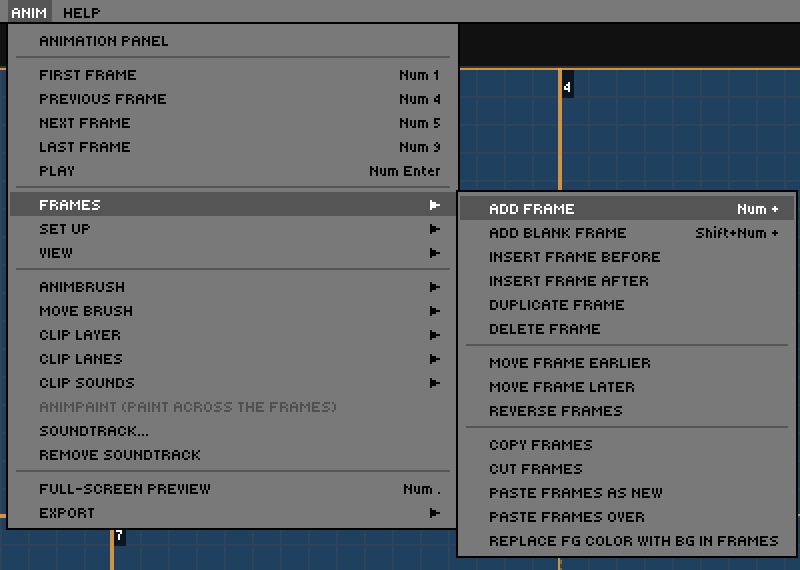
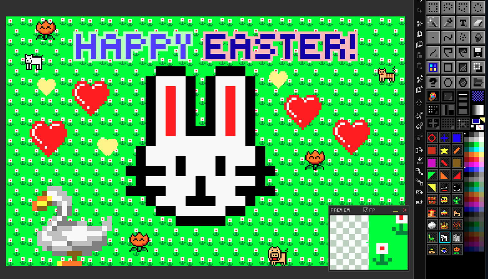

# Ch. 09  🪄 Custom Brushes & Drawer Panel

> **What you'll learn:** How to capture, transform, recolor and stamp custom brushes; the 30-slot Drawer panel for brush / pattern / gradient libraries; and DRAW's six dithering algorithms.

---

## Custom Brushes — Capture, Transform & Paint

> 🎯 **Goal:** Create and use custom brushes.

A **custom brush** is any selection captured into the brush slot — DRAW remembers the pixels and treats them as the active stamp for every drawing tool that supports stamping.

### Capturing

Make a selection, then capture it as a brush via the Brush menu, the Organizer button, or the Command Palette. There are two capture modes:

- **From Current Layer** — only non-transparent pixels.
- **From Selected Layers** — union mask across the multi-selection.

Non-rectangular shapes are preserved via the alpha channel.

### The ANIM menu

Everything for frames lives in the **ANIM** menu. The things you use all the time
are on top - the Animation panel, First / Previous / Next / Last Frame, Play and
Full-Screen Preview - and the rest is grouped in flyouts:

| Flyout | What's in it |
| --- | --- |
| **Frames** | Add, insert, duplicate, delete, move, reverse, copy / cut / paste frames |
| **Set Up** | Frame Grid, Detect Frames, Import PNG Sequence; reference / same-on-every-frame / linked layers; tags and frame notes |
| **View** | Lightbox, panes, X-sheet, Big Frame + X-Sheet, onion skin, Preview Shows Frame, clip strokes to the frame |
| **AnimBrush**, **Move Brush** | The two brushes below |
| **Clip Layer**, **Clip Lanes**, **Clip Sounds** | Clip layers, their keyframe lanes and their sounds (below) |
| **Export** | Animated GIF, APNG, PNG sequence, sprite sheet, BAS player, export scale |

AnimPaint and the soundtrack stay on the top level. Every item is also in the
command palette (`?`), so you can type its name instead. The **Sprite**, **Animate**
and **Scene** workspaces ([Chapter 22](22-workspaces-capture.md#workflow-buttons)) set DRAW up for each kind of animation work
with one click on the workflow buttons above the toolbox.

### AnimBrush - a brush with a picture per frame

On a sprite sheet (a document with frames), **ANIM → AnimBrush → Pick Up** makes a brush
that has one picture - a *cel* - for each frame:

1. Draw a selection around the part you want inside one frame (a marquee, ellipse, lasso or
   magic wand; the shape is kept).
2. To take only some frames, Ctrl+click them in the lightbox strip first, or click a tag on the
   X-sheet (the brush is then named after the tag - you see the name in the status bar and on
   its bin). Otherwise the cels come from every frame.
3. Choose **Pick Up** (the current layer) or **Pick Up Merged** (every visible layer).

> 💡 **Quicker: hold `B` while you make the selection.** When you let go of the mouse the
> selection is picked up and you are on the Brush: an AnimBrush on a picture with frames, a
> plain brush (as `Ctrl+B`) on one without. A quick tap of `B` still just picks the Brush.

DRAW reads the same spot in every frame's cell - the gutter and margin between cells are
skipped - so a walk cycle becomes a walking brush. The tool switches to the Brush, and the
brush under the pointer is always the cel your next stamp will use; the status bar shows it
too (`ANIMBRUSH 3/8 FOLLOWS FRAME`: cel 3 of 8).

**Step modes** (ANIM → AnimBrush):

- **Cel follows the frame** (the default) - on frame 5 the brush uses frame 5's cel. Stamp the
  same spot on each frame and the flame burns there. The frame you picked the brush up from gets
  cel 1; `Alt+\` makes the current frame cel 1 instead.
- **Next cel each click** - every press moves on one cel, so a row of torches on one frame
  don't flicker in step. On a picture without frames the brush always works this way.
- **Every frame at once** - one press stamps the brush on every frame, each with its own cel,
  cut at the edge of each frame's cell. Ctrl+Z takes the whole thing away in one step.

**Order** runs the cels Forward, Reverse, Ping-Pong (1 2 3 4 3 2 ...) or Once (holds the last
cel). `Alt+]` and `Alt+[` step to the next / previous cel. `Ctrl+B`
drops the AnimBrush; `Ctrl+B` over a selection still makes an ordinary one-picture brush.
Switching to Pattern or Gradient mode puts the AnimBrush away with its cels, and Color mode
brings it back.

Everything in **Transform controls** and the recolor / outline modes below works on an
AnimBrush too: Rotate 90° (`>` / `<`), Scale 2x (`Ctrl+Home` / `Ctrl+End`) and Outline
(`Shift+O`) change **every** cel, not just the one you see; Flip, Scale and Recolor are applied
to whichever cel a stamp uses. With the **Eraser** an AnimBrush erases each frame's own cel
shape (with *Every frame at once*, the whole animation in one press). In the lightbox, a stamp
in another frame's pane lands in that frame and uses that frame's cel.

### Move Brush - a brush that travels across the frames

**ANIM → Move Brush** stamps the brush once in each frame along a path, so a ball rolls or a
bird flies through the animation without placing every frame by hand. It works with any custom
brush; with an AnimBrush the bird flaps as it flies.

1. Pick up a brush (`Ctrl+B` over a selection, or an AnimBrush).
2. Choose **ANIM → Move Brush → Start**. The status bar shows `MOVE BRUSH`.
3. Drag the path in a frame - on the sheet, or in a lightbox pane. A see-through ghost of every
   stamp shows along it, with a dot for each frame. Drag again to try another path.
4. Press `Enter` to stamp it (`Esc` cancels). The first frame gets the brush at the start of the
   path, the last frame at its end, the frames between along the way - each in its own cell.
   `Ctrl+Z` takes the whole move away in one step.

Which frames: the ones selected in the strip (Ctrl+click two or more), else the frame you drag
in through the last frame. In the same menu:

- **Ease** - *None* spaces the stamps evenly; *In* starts slow and speeds up; *Out* starts fast
  and slows down; *In-Out* is slow at both ends.
- **Next Cel Every Frame / 2 / 3 / 4** - with an AnimBrush, how often it moves on to its next cel
  (a slow walk: every 2 frames).

**Turn, size, fade and tint over the move.** While Move Brush is on, the Animation panel shows
the move's settings in place of its frame rows (it opens for the move if it was shut). Every
number is a box you can drag, wheel, click to type, or middle-click for its default:

- **MOVE X / Y / Z** - X and Y are where a straight path ends. Type them instead of dragging: with
  no path yet the move starts in the middle of the frame. **Z** moves the brush away from you
  (or toward you, with a minus) in perspective: it shrinks as it heads for the middle of the frame.
- **TURN X / Y / Z** - degrees over the move. Z spins the brush flat (360 = once round); X and Y
  tilt it in 3D, like a coin flipping.
- **SIZE**, **OPACITY**, **TINT** - each has a start and an end value: grow from 20 % to 100 %,
  fade in from 0 to 100, or turn toward the FG colour.
- The **ease** applies to all of them. **PLAY** shows the ghost one step at a time; **RESET**
  puts Z, turn, size, opacity and tint back.
- **PATH: DRAWN** makes the stamps follow the shape you drag instead of a straight line.

So a coin spinning in place is: pick up the coin, Start, type **TURN Y 360**, Enter.

### AnimPaint - painting across the frames

**ANIM → AnimPaint** turns the brush into a recorder: press in a frame, drag, let go, and each
frame from there on gets the brush where the pointer was at that frame's moment - at the
animation's FPS, each frame lasting its hold. Draw a slow wiggle and a firefly wanders; draw
quickly and it darts. The stroke lands when you let go (Ctrl+Z takes it back in one step) and
AnimPaint stays on for the next stroke; Esc stops it. The size, turn, opacity and tint settings
above apply here too.

### Clip layers - an AnimBrush that keeps playing

A stamp is pixels: once it lands, changing your mind about timing means erasing and stamping
again. A **clip layer** keeps the AnimBrush itself, so a torch flickers, a coin spins or a
character walks on the spot for as long as the animation runs, and you can change when it
starts, how fast it plays or where it sits at any time.

1. Pick up an AnimBrush.
2. Choose **ANIM → Clip Layer → Place AnimBrush as Clip**, then click in a frame. A new layer
   appears above the current one, named after the AnimBrush with `[C]` in front. Cel 1 is in the
   frame you clicked, where you clicked, and the clip plays to the last frame. `Esc` or a
   right-click cancels before you click.
3. The Animation panel opens on the clip's settings (they replace the frame rows while a clip
   layer is the current layer; the `|< < PLAY > >|` row stays so you can scrub):
   - **LOOP / PING / ONCE / HOLD / REV** - play the cels round and round, back and forth, once
     (then nothing), once and stay on the last cel, or backwards.
   - **IN / OUT** - the first and last frame it shows in. `END` means to the last frame, and
     stays that way when you add frames.
   - **CEL / EVERY** - the cel it starts on, and a new cel every N frames (2 = on twos).
   - **X / Y** - where the cel sits in each frame's cell.
   - **FLIP X / FLIP Y** mirror every cel. **BAKE** - see below.

   Each number is a box: drag it, wheel over it, click to type, or middle-click for its default.
   The same settings are in **ANIM → Clip Layer**, and `Image → Flip Horizontal / Vertical`
   flip the clip too.

**Moving it:** the Move tool (`V`) drags the clip in a lightbox pane and every frame follows; the
arrow keys nudge it 1 px. **Frames:** adding, inserting, deleting or reordering frames leaves the
clip layer alone and moves its IN / OUT with the frames around it.

**What you can't do to it:** a clip layer's pixels are rebuilt from the clip, so painting on it,
Cut, Paste, Clear, Scale, Rotate, Transform and Effects are refused with a message in the status
bar, and Merge Down onto it is refused. **Bake Clip to Pixels** (ANIM → Clip Layer, the panel's
BAKE button, or the layer's right-click menu) turns it into a normal layer with the pixels it
shows; `Ctrl+Z` brings the clip back. Merging a clip layer down into the layer below also
keeps just its pixels.

Every change is one undo step (a drag on a number box too). The clip is saved in the `.draw`
file with a copy of its cels, so it doesn't need the Drawer slot it came from; every export -
GIF, APNG, PNG sequence, sprite sheet, BAS - shows it frame by frame. A DRAW too old to know
clip layers opens the file with the clip as a normal layer of pixels.

#### More ways to make a clip

- **Make Clip from Selected Frames** (ANIM → Clip Layer): draw a selection around something
  that already moves across your frames - select the frames in the lightbox strip first, or
  leave them all - and it becomes a clip. The pixels are cut from the layer and the clip shows
  them in the same frames at the same place, so nothing looks different, but now you can move
  it, slow it down or loop it.
- **Drop an animated GIF or APNG** onto the canvas while the document has frames: it becomes a
  clip starting in the frame under the pointer. (A `.draw` file still opens as a document, and a
  PNG sprite sheet still becomes a brush.)
- **Update Clip from Bin / from AnimBrush** swaps a clip's cels for the Drawer bin it came from
  (after you changed that bin) or for the AnimBrush you are holding. Every clip using the same
  cels changes with it.

#### The clip on the X-sheet

On the X-sheet a clip layer's row is a bar from its IN to its last frame, with the cel each
frame shows. Drag either end to change IN or OUT, or drag the middle to slide the whole clip
along the frames. Each drag is one undo step.

#### Sharing cels between clips - clip sources

The cels of a clip are its **source**. Duplicating a clip layer gives you a second clip on the
same source, and the Animation panel's **SOURCE** row (under the clip settings) works on it:

- `<` / `>` - switch the clip to the previous / next source in the document.
- **RENAME** - name the source (every clip on it shows the new name).
- **LAYERS** - select every layer using this source.

**ANIM → Clip Layer → Clip Sources...** lists every source, its cels and the layers using it.
**Remove Unused Clip Sources** clears the ones no layer uses (they come back if you undo your
way to a layer that used them).

#### Editing a clip's cels

**ANIM → Clip Layer → Edit Clip Cels** puts the clip's cels on a new layer (named
after them, e.g. **Cels of torch**): cel 1 on frame 1, cel 2 on frame 2 and so on, where the clip sits. The clips using
those cels are hidden while you work. Paint on that layer with any tool, then choose
**Apply Cel Edits**: every clip on that source plays the new cels, and the layer goes away.
One `Ctrl+Z` undoes the whole Apply. **Discard Cel Edits** just removes the layer. The clip
needs as many frames as it has cels, and its cels must fit in a frame.

#### Sounds on a clip

A clip can carry its own sounds, and they travel with it wherever it plays:

- **Sound on This Cel...** - plays whenever the cel showing in the current frame comes up (a
  footstep on the walk cycle's contact cel).
- **Sound When the Clip Starts...** - once, on its IN frame.
- **Sound Each Time the Clip Starts Over...** - on IN, and again each time its cels loop.
- **Remove the Clip's Sounds** - all of them.

The same three are the **SOUND** row's `CEL` `START` `LOOP` buttons in the Animation panel;
the row under it shows one sound at a time - `<` / `>` step through them, `X` removes that
one. Every clip on the same source plays the sounds. A hidden clip layer is silent. On the
X-sheet, a clip with sounds has a **SOUND** row under it that marks where each one plays
(read-only - edit the sounds in the panel). The sounds play with the animation and go into
the BAS export's audio. **Bake Clip to Pixels** asks whether to keep them: **Yes** (`Enter`)
turns them into ordinary soundtrack clips, **No** (`Esc`) drops them. The `.draw` file keeps
the sounds' file paths, the same way the soundtrack does.

#### Moving a clip - keyframe lanes

A clip can move, grow, turn, fade or change colour over its frames. Each of these is a
**lane**: **X**, **Y**, **SCALE X**, **SCALE Y**, **ROTATE**, **OPACITY**, **TINT** (toward
the clip's tint colour), **PIVOT X** / **PIVOT Y** (where it scales and turns about), and for
its sounds **VOLUME** and **PAN**. A lane holds **keys** - a frame and a value - and moves
smoothly from one key to the next.

In the Animation panel's clip rows:

- **LANE** - `<` / `>` pick the lane; the box shows its value on the current frame. Type,
  drag or wheel the box and the value is **keyed on this frame** (a new key, or the one
  already there). A `*` after the lane's name means this frame has a key.
- **KEYS** - how many keys the lane has, **KEY** (key the value here), **DEL** (remove the
  key here) and the **ease** of the key at or before this frame: LINEAR, IN, OUT, IN-OUT
  (the Move Brush's eases) or HOLD (stays put until the next key).
- **MOD** - a wobble added on top of the lane: OFF, SINE, TRI, SQUARE, SAW (repeating) or
  NOISE (a seeded jitter - the same every time it plays). Its boxes are AMOUNT (in the
  lane's unit), PERIOD (frames) and PHASE (frames; the SEED for noise). A firefly bobbing:
  Y, SINE, amount 3, period 12. A flame flickering: OPACITY, NOISE, amount 20, period 2.

Keys count from the clip's IN, so a clip slid along the X-sheet keeps its moves. Before the
first key the lane holds the first key's value, after the last the last one's. Positions are
whole pixels, so a slow move steps one pixel at a time.

Other ways to key:

- The **Move tool** on a clip that has X or Y keys keys the current frame instead of moving
  the whole clip (drag or arrow keys). Without X / Y keys it moves the clip as before.
- The **X-sheet** shows a **LANES** row under a clip with keys: a diamond on each frame with
  a key, filled where the lane picked in the panel has one. Drag a diamond along the row to
  move that frame's keys to another frame.
- The **arrow** before a clip's name on the X-sheet opens its **lane rows**: one per lane in
  use, plotting the value along the frames with its eases, then **+ LANE**. Drag a key along
  the row to retime it, up / down to change it; double-click to add a key or type a value;
  right-click for the ease, the modulator and Remove Lane. A key can turn the modulator off,
  make it one cycle (one-shot) or restart it until the next key, and **Modulator Envelope…**
  (attack, decay, sustain, release) shapes it from each key; the line shows the real wave.
  **Add Frequency Lane** / **Add Amplitude Lane** add a **~FREQ** / **~AMP** row under the lane
  to key the modulator's period and amount over time (a shiver that speeds up, a wobble that
  dies away).
- **ANIM → Move Brush → Apply as Clip** makes the Move Brush's move a clip layer instead of
  stamping it: the brush (an AnimBrush's cels, or a plain brush) plays over the move's
  frames, with the move in its lanes - a straight path as two keys with the move's ease, a
  drawn path as a key per frame, plus its SIZE, OPACITY, TINT and TURN Z. Z and the 3D
  turns have no lane and are left out (Apply still stamps them).
- **ANIM → Clip Lanes**: **Clear This Lane**, **Clear All Lanes**, **Copy Lanes** /
  **Paste Lanes** (onto another clip layer), **Tint Toward the Foreground Colour** (the
  colour the TINT lane goes toward).

VOLUME and PAN set each of the clip's sounds to the lane's value on the frame it starts
(a sound keeps its level while it plays). Every lane is one `Ctrl+Z` per change, is saved
in the `.draw` file, and is in the pixels that onion skin, playback, Bake and every export
use.

### Holds and lanes on any layer

Two more things on the X-sheet work on **any** layer, not just clips:

- **Per-layer holds** - drag a cell's right end along its row and that layer's drawing shows
  for as many frames as you cover (the other layers keep animating); drag it back and the
  frames let go are blank. Right-click a cell (or ANIM → **Hold for N Frames…** /
  **Release Hold**) to type it.
- **Keyframe lanes on pixel layers and groups** - the same lane rows as a clip's (X, Y,
  SCALE X / Y, ROTATE, OPACITY, TINT, PIVOT X / Y), from the arrow before the layer's name.
  A pixel layer also has **BLEND**: its blend mode per frame - right-click the row on a frame
  and pick a mode; it holds until the next key.
  **Effect lanes** - **BLUR** (radius), **PIXELATE** (block size), **INVERT** (0-100 %) and
  **NOISE** (a grain, new every frame, or held from a key: **From This Key: Frozen Grain**) -
  are under **+ LANE** too, on pixel layers and groups. They change how the layer looks on each
  frame (after it is moved) in the canvas, playback and every export.
  A group's lanes move every layer in it. The pixels never change: the canvas, the
  lightbox, playback and every export show each frame through its lanes, clipped to the
  frame.

- **Select keys with a box** - drag on empty lane space (a crosshair) to box frames across
  any lane rows, even several layers'. Drag inside the box to move those keys in time (hold
  `Alt` to copy them); `Ctrl+C` / `Ctrl+X` / `Delete` copy, cut or delete them, and `Ctrl+V`
  pastes them at the current frame - into the current layer's lanes of the same kind when
  they came from one layer, so another layer can take the same motion. A copy adds a key at
  each edge of the box, so the pasted stretch has the same curve you saw. `Esc` clears the
  box. (Also ANIM → Copy / Cut / Paste / Delete Keys.)
- **Layers on the X-sheet** - `Ctrl` / `Shift`+click layer names to select several (the
  same selection as the Layers panel), then `Ctrl+Shift+G` to group them or `Ctrl+Shift+U` to
  ungroup; drag a name up or down to move the layer, into or out of a group, in one undo step.
- **Lane thumbnails** - a layer the lanes move shows, on its main X-sheet row, a thumbnail
  at each frame a lane has a key, drawn through the lanes (what the canvas shows on that
  frame), with the hold line running on between them. A group shows its layers together at
  its own keys. Right-click the X-sheet's header → **Lane Thumbnails: Off / Keyframes /
  Every Frame** (Every Frame: each frame the lanes change the layer), or Settings →
  Animation.
- **Keys show their ease** by shape: a diamond is LINEAR, `[>` EASE IN, `<]` EASE OUT, a
  circle EASE IN-OUT, a square HOLD. Each lane has its own colour (Settings → Animation),
  and the curves are drawn smooth.

#### Recording: arm a layer and use your tools

Click the **record dot** on a layer's X-sheet row (or left of its opacity bar in the Layers
panel - shown on animations only), or right-click the layer → **ARM FOR RECORDING**. Red =
armed; purple = not armed but keyed. On an armed layer, on the current frame:

- the **Move tool** (drag or arrow nudges) keys **X / Y**;
- **Transform → Scale / Rotate**, committed, keys **X / Y / SCALE / ROTATE**;
- **Flip Horizontal / Vertical** (`Home` / `End`) keys a negative **SCALE X / Y**;
- the **opacity** bar, slider, wheel or `1`-`0` keys **OPACITY**.

The pixels never change, each gesture is one undo step, and the lane being changed shows a
purple dot while its curve moves with you.

In the **lightbox**, the current frame's pane shows the armed layer's **transform widget**: a
box round its drawing with corner / edge handles (scale; `Shift` uniform), a knob (rotate;
`Shift` 15°; `Ctrl` the angle snap from Settings - Snap Degrees, or the pixel-art angles) and a pivot crosshair, plus a bar with an **OPACITY** slider, a **TINT** chip
(`Shift+click` = the FG colour; click = follow the FG colour through the Color Mixer) and a
**TINT** slider. A tip shows old → new while you drag. `Ctrl+Alt+Shift+wheel` over it fades
the widget; `Ctrl+Alt+Shift+middle-click` restores it.

#### The LANES page of the Animation panel

The **LANES** chip on the Animation panel's status row (on an animation, for any layer that
can have lanes) swaps the frame rows for every lane of the current layer: its name (click to
pick), a key button (add / remove the key on this frame; it shows the key's ease shape) and
its value on this frame - click to type, drag up / down or wheel to change it, middle-click
for its default. `<KEY` / `KEY>` jump between keyed frames, and **EASE** / **MOD** set the
picked lane's ease and modulator. With it you can hide the X-sheet and still key everything.

The full how-to, with every gesture and some recipes, is the field guide
`docs/XSHEET-HOLDS-AND-LANES.md`.

### The AnimBrush pack and example scenes

DRAW ships with **`animbrush-pack`**, a Drawer brush set of 15 AnimBrushes: torch, campfire,
smoke, star, firefly, flag, bat, ghost, owl, waterfall, splash, ripple, grass, butterfly and
bird. Pick it from the Drawer's brush set list; hovering a bin plays it, and the number in its
corner is its cel count.

To build a scene from it:

1. **File → New Animation…** - choose a frame count every loop divides into (24 fits loops of
   2, 3, 4, 6, 8 and 12 cels, so nothing jumps when the scene wraps).
2. Draw the background in frame 1 and turn on **ANIM → Set Up → Layer Same on Every Frame**.
3. `Num 0` (the lightbox), then **ANIM → AnimBrush → Every Frame at Once**.
4. For each thing that animates in place: a new layer (`Ctrl+Shift+N`), click its bin, press
   `Alt+]` a few times so it is out of step with its neighbours, and click where it goes.
5. For each thing that travels: **Move Brush**, drag its path, `Enter`.

Three finished scenes built this way are in **`SAMPLES/ANIMBRUSH/scenes/`**: a castle at night,
a campfire in the woods and a waterfall valley, every element on its own layer. Each brush is
also in `SAMPLES/ANIMBRUSH/brushes/` as a strip with frame data, for **AnimBrush → Load…**.

### Animated scenes with sound

**`SAMPLES/ANIMSCENES/`** has nine longer scenes (48–64 frames, 12 fps), each with its **own
AnimBrush pack** and a **soundtrack** (a music track and a sound-effects track, timed to the
frames). They show what the Move Brush's numbers do across many frames - position on straight
and drawn paths, SIZE, MOVE Z (perspective), TURN X / Y / Z, OPACITY and TINT:

| Scene | What moves |
| --- | --- |
| `space` | parallax star layers, a ship curving down to the planet (Z + turn + tint), a cut to the surface through black, a lander touching down in dust |
| `alien-attack` | an invaders-style loop: a marching formation, a tracking tank, shots, flipping bombs, a mothership blown apart (size + spin + tint + fade) |
| `brick-breaker` | a simulated rally: the ball on a drawn path, bricks bursting, a capsule flipping into the paddle |
| `bakery` | a sunlit table: steam puffs that grow and fade, dust motes on drawn loops, a sunbeam that brightens and warms |
| `beach` | flapping umbrellas, rolling surf, a spinning beach ball, a gull sailing toward you (size) and one flying away (Z), a sunbather turning red (tint) |
| `dungeon` | flickering torches and skull candles, spiders on silk, a ghost fading in and out, a bat flying at you |
| `fireworks` | rockets, bursts that grow, fade and cool from white (size + opacity + tint), a tilted ring (turn X), a pinwheel, a finale |
| `platformer` | a robot running and jumping on drawn arcs, coins flipping (turn Y), the fall into the pit (tumble + Z + red + fade), GAME OVER |
| `stormy-night` | the extra pack: rain and lightning, a TV, a radio, a computer, a snow globe, a dog, a cat and two monsters |

Open `NAME.draw`, `Num 0` for the lightbox and `Num Enter` to play it with its sound. The
pack is `NAME-pack.dset` (Drawer → Load Set); `NAME-moves.txt` lists every Move Brush the
scene used with its numbers, so you can rebuild any element yourself: pick the bin, **Move
Brush → Start**, drag the path, type the same values and `Enter`.

### Animation projects - clips, lanes and tags together

**`SAMPLES/ANIMPROJECTS/`** has four complete projects (64 frames, 12 fps) that use the clip
features together: clip layers with keyframe lanes and every ease, modulators, clips sharing
one source, sounds on clips (on a cel, when it starts, each time it loops) with VOLUME and
PAN lanes, Make Clip from Selected Frames, Move Brush → Apply as Clip, Bake Clip to Pixels,
tags for the acts, frame notes, holds, a reference layer and linked cells - and a soundtrack.

| Project | Acts (tags) | What to look at |
| --- | --- | --- |
| `reef` | CALM / SHARK / TREASURE | five fish of one source darting (X keys, ease in) at five Y-sine phases; kelp swaying about its foot (ROTATE triangle + PIVOT Y); a jellyfish rising and pulsing (SCALE Y sine) that blubs each loop; the shark's rumble panned left to right (VOLUME / PAN keys); the chest held open and tinted gold |
| `neon` | RAIN / TRAFFIC / BLACKOUT | windows tinted toward TV cyan going dark one by one (OPACITY hold keys); BAR blinking (square), HOTEL buzzing (noise) then dying; two cars, one flipped, their engines faded and panned; lightning with thunder when it starts |
| `carnival` | DAY / DUSK / LIGHTS | a ferris wheel (ROTATE saw) with four gondolas riding its circle (X sine + Y sine a quarter apart); three balloons of one source turned blue in one step (Update Clip from AnimBrush); a runaway balloon (mode Once, a pop on a cel); the lights chasing (OPACITY square) |
| `farm` | DAWN / NOON / DUSK / NIGHT | the sun's arc (X / Y keys with eases, TINT keys); a far windmill baked to pixels; the tractor's bump keyed by nudging the clip with `Ctrl`+arrows; a sheep drawn as four frames and made into a clip; fireflies (X / Y noise, own seeds) and the owl at night |

Open `NAME.draw`, `Num 0` and `Num Enter` to play it with its sounds. Click a clip layer and
the Animation panel shows its settings: pick a lane with **LANE `<` `>`** to see its keys and
modulator, then step through the frames to watch the values change. `NAME-clips.txt` lists how the project was built, clip by
clip and key by key, so you can rebuild any part of it. Keep the WAVs beside the `.draw` -
DRAW finds the clips' sounds and the soundtrack there by name.

> 💡 For composing a scene like these, **ANIM → View → Big Frame + X-Sheet** shows the lightbox as one
> big pane (the current frame) under the X-sheet: you see the whole picture large while every
> layer's frames and the sound stay in view. Choose it again (or `Num *`, which steps
> 1 / 3 / 5 / 7 panes) to go back.

### Transform controls

| Action | Key |
| --- | --- |
| Flip Horizontal | `Home` |
| Flip Vertical | `End` |
| Scale Up | `PgUp` |
| Scale Down | `PgDn` |
| Reset Scale | `/` |

### Modes that work *with* a custom brush

| Tool | Effect |
| --- | --- |
| Brush / Spray | Stamp the brush at every step. |
| Line / Rect / Ellipse / Polygon | Stamp along the geometry. |
| Fill | **Tiled fill** of the brush as a seamless pattern. |
| Eraser | Stamp transparency in the brush shape. |

### Recolor and outline modes

- **Recolor** (`F9`) — paints the brush in the current FG color, preserving its alpha.
- **Outline** (`Shift+O`) — adds a BG-colored outline around the brush silhouette.

### Export

`F12` exports the current brush as a standalone PNG (alpha preserved) — perfect for sharing brushes between projects.

> 🎨 **Try it — leaf scatter**
> 1. Draw a small 8×8 leaf on a transparent layer.
> 2. Marquee around it; capture as custom brush.
> 3. Switch to Spray, increase brush size, set FG to a green family.
> 4. Spray a tree's foliage onto a new layer in seconds.

## MyPaint Brushes — Natural Media

DRAW paints with **MyPaint's brush engine** (libmypaint 1.6.1, built in - nothing to install) and loads MyPaint's own `.myb` brush files: pencils, charcoal, inks, watercolours, smudge and blend brushes, airbrushes, knives. The brushes that come with MyPaint ship with DRAW, all seven sets (196 brushes, CC0 - free for any use): Classic, Deevad, Dieterle, Experimental, Kaerhon, Ramon and Tanda.

### Picking a brush

**Tools > MyPaint Brush** picks the tool and opens the **MyPaint Brushes** palette (also **View > MyPaint Brushes**). It is a dock panel like the others: it docks in a column on the right, floats, tabs, or docks along the top or bottom.

- **`<` / `>`** (or the wheel over the top rows) step through the groups - MyPaint's own grouping, then **MY BRUSHES** (your own).
- **Click a brush** to use it; that picks the MyPaint tool too. The brush in use has a coloured frame; the row above the grid names the brush under the pointer.
- **The wheel over the grid** scrolls it.
- The size shown at the right of the **LOAD / SAVE** row is the brush's base radius (before pressure and speed change it).

### Painting

Paint with the left button in the **FG** colour, the right button in the **BG** colour. It paints into the current layer, one undo step per stroke.

- **A pen** gives the brush its pressure and tilt (after Pen Control's pressure curve). The mouse paints at half pressure, as in MyPaint - or at the **PRESSURE** you set in the MyPaint Brush Settings panel.
- **`[` / `]`** make the brush smaller / bigger while the MyPaint tool is active (steps of 0.2 in MyPaint's log radius, about 22%). **MyPaint Brush: Reset Size** in the command palette (`?`) goes back to the size the brush was made at.
- **Smudge and blend brushes** pick up the colours already in the layer.
- It honours the **selection**: a feathered or antialiased selection fades the paint at its edges. It also honours the layer's **opacity lock** (the alpha stays).

### MyPaint Brush Settings

**View > MyPaint Brush Settings** opens a panel of sliders for the brush in use, the same ones MyPaint's Freehand tool options have. It docks like any panel (under the MyPaint Brushes palette by default). It floats, and it lays its sliders side by side when docked along the top or bottom.

| Slider | What it changes |
|---|---|
| **SIZE** | The brush size, the same as `[` / `]` and the Brush Palette (the brush's radius over its own when Size From Brush Size is off) |
| **OPAQUE** | How much paint each dab puts down (0..2) |
| **SHARP** | The dab's edge, soft (0) to hard (1) |
| **GAIN** | How strongly pen pressure acts (-1.8..1.8) |
| **PIGMENT** | 1 mixes the colours like paint, 0 like light |
| **SMOOTH** | The stroke lags behind the pointer, evening out shaky lines (0..10) |
| **PRESSURE** | The pressure the **mouse** paints with, % (a pen uses its own) |
| **TWIST** | The pen's barrel rotation in degrees, for the brushes that read it |

OPAQUE to SMOOTH change the loaded brush only: picking another brush brings back its own values. **RESET** puts every slider back to the brush as it was made. **SAVE** keeps the brush with your values in **MY BRUSHES**.

Every slider in DRAW takes the same mouse controls: **the wheel** moves it 1 (**Shift**: 10), **a middle-click** or **a double-click** on it resets it, and **a double-click on its value** lets you type one.

### Loading and saving brushes

- **LOAD** (or **Tools > Load MyPaint Brush...**) opens any `.myb` file, for example a brush pack downloaded for MyPaint.
- **SAVE** (or **Tools > Save MyPaint Brush...**) writes the brush as it is now - its size included - into **MY BRUSHES**. DRAW paints a preview thumbnail for it (`<name>_prev.png` beside it), the way MyPaint's own brushes have one.
- **Your brushes live in** `MYPAINT-BRUSHES/` in DRAW's data folder (`./DRAW.run --dir-data` prints it). Any `.myb` you copy there shows up in MY BRUSHES.

### Settings (DRAW.cfg `[MYPAINT]`)

| Key | What it does |
|---|---|
| `MYPAINT_BRUSH` | The `.myb` in use (empty: Classic / pencil) |
| `MYPAINT_SIZE_FROM_BRUSH` | `TRUE` (default): the MyPaint brush is DRAW's brush size (its diameter, 1–101 px). `FALSE`: each brush keeps its own size (command *MyPaint Brush: Size From Brush Size*) |
| `MYPAINT_SIZE` | With `MYPAINT_SIZE_FROM_BRUSH=FALSE`: size offset in tenths of a log step, -40..40 (`[` / `]`) |
| `MYPAINT_PANEL` | The palette shows |
| `MYPAINT_SET` | The group the palette shows |
| `MYPAINT_CELL` | Thumbnail size in px, 24..128 |
| `MYPAINT_SETTINGS` | The MyPaint Brush Settings panel shows |
| `MYPAINT_MOUSE_PRESSURE` | The mouse's pressure, % (default 50) |
| `MYPAINT_TWIST` | The barrel rotation every stroke gets, degrees |
| `MYPAINT_PANEL_SCALE` | The palette's own Scale (0 = the UI Scale; 1 to 8 in half steps, e.g. `1.5`) |

---

## Brush Palette — Shapes and Sizes

**View > Brush Palette** opens a dock panel for the brush that the **Brush**, **Eraser**, **Line** and shape tools paint with. It works in any dock shape - a narrow column, two columns, along the top or bottom, or floating. The grid of sizes wraps to the width it gets and scrolls in the height.

- **The shape chips** at the top: **ROUND**, **SQUARE**, and two **SLANT** nibs (`/` and `\`), calligraphy pens that make thick and thin lines depending on the stroke's direction.
- **SIZE** picks the size (1 to 101 px, as `[` / `]`). **SOFT** fades the edge over that much of the radius: 0 is hard, 100 is feathered all the way from the centre. Soft works on round and slant brushes; a square brush stays hard.
- **The grid** shows every size as it paints, in the current shape and softness. Click one to use it. The wheel over the grid scrolls it, or changes the size when every size already shows.
- The sliders take the universal mouse controls: the wheel (**Shift** for 10), a middle-click or a double-click to reset, a double-click on the value to type one.

DRAW.cfg `[BRUSH_PALETTE]`: `BRUSH_PANEL` (it shows), `BRUSH_PANEL_SCALE`, `BRUSH_PANEL_CELL` (thumbnail px, 16..64), `BRUSH_SOFT` (the softness, kept between runs). A `.draw` file remembers a slant shape.

## Drawer Panel — 96 Reusable Slots

> 🎯 **Goal:** Organize and reuse brushes and patterns.

The **Drawer panel** is a docked grid of 96 slots per mode that hold reusable brushes, patterns, or gradients. Each slot is one click away from being the active stamp.

  

### Drawer modes

| Mode | Shortcut | Use for |
| --- | --- | --- |
| Brush | `F1` | Stamping and painting. |
| Gradient | `F2` | Color transitions for fills. |
| Pattern | `F3` | Seamless tiled fills. |

### Storing and managing slots

| Action | Result |
| --- | --- |
| `Shift`+Left-click an empty slot | Store the current brush there. |
| Right-click any slot | Context menu — load, save, clear, replace, export, etc. |
| Drag-and-drop slots | Reorder. |
| Drop image files onto the panel | Batch import as slot brushes. |

**Load an AnimBrush from a file.** **ANIM → AnimBrush → Load…** makes an AnimBrush from an
animated GIF or APNG (its frames, as a player shows them), a PNG or `.draw` with frames (its
cells), or a plain picture that is a row or column of squares (a strip). The cels are cropped
to the area anything is drawn in, keeping each cel's place. Drop such a file on a Drawer bin
and it lands there as an AnimBrush bin (the bin under the pointer if it is empty, else the
first free one); a picture without frames dropped on a bin is an ordinary brush, as before.

**AnimBrush bins.** `Shift`+click a bin while you hold an AnimBrush and the bin keeps every
cel: it shows cel 1 with a small film-strip badge holding the cel count, and while you hover
it the bin plays (at the animation's FPS) - so does the Preview's Bin Quick Look. Click the
bin to get the AnimBrush back, cels and all. Dragging the bin moves its cels with it; storing
a plain brush over it makes it one picture again. AnimBrush bins are saved in `.dset` sets and
in `.draw` files; an older DRAW opens those with the bin's first cel only.

### `.dset` import / export

The drawer state can be saved as a `.dset` file and reloaded later — a clean way to share brush packs and pattern libraries between projects or with other artists. There's a sample set in `DEV/brush-set.dset`.

DRAW 2.8 has **96 slots** per mode (earlier versions had 30). Sets and `.draw` files keep working both ways: an older DRAW opens a new file with its first 30 slots, and a new DRAW opens an old file with the slots after 30 empty.

### Mini palette

The Drawer can show a **mini palette** beside its bins for quick FG / BG selection (left / right click). It is **off by default**: turn it on in **Settings → Panels → Drawer → Mini Palette**. With it off, the bins take its space (more columns and rows). For a full swatch panel, see **View → Swatches**.

### Narrow and wide toolboxes

The drawer fits the toolbox column's width (drag the toolbox's inner edge, or
set its columns in a workspace):
- **Wider than the default 4 columns:** up to 6 bin columns, so fewer rows.
- **Without the mini palette** (the default): as many bin columns as fit the width, up to 6.
- **Narrow:** fewer bin columns. When even one bin can't sit beside the mini palette (if it's on), the palette moves under the bins.
- **Not every row fits:** **`Shift`+wheel** over the bins scrolls them. The plain wheel still switches `.dset` sets.
- **The bins fill the width:** they grow to span the drawer, so no strip is left at the right.
- **See a bin big:** hover it and the Preview panel shows it enlarged (Bin Quick Look, see Chapter 11).
- **Zoom:** **`Ctrl`+wheel** over the bins zooms them: wheel up gives fewer, bigger bins per row (down to 1), wheel down gives more, smaller ones (up to 12). DRAW remembers the zoom (`DRAWER_BIN_COLS` in DRAW.cfg). To go back to the automatic size, right-click a bin and choose **Bin Size: Auto**. Docked in a row along the top or bottom, the bins run across the row instead, so there `Ctrl`+wheel sets how many rows of bins fit the row's height: wheel down gives 2, 3… rows of smaller bins (up to 6), wheel up goes back to one row as tall as the row (`DRAWER_ROW_BIN_ROWS`). For bigger bins than that, drag the row's edge to make it taller.

### 1-bit patterns

Patterns can be stored with **opaque backgrounds** (1-bit black/white) so that flooding with a 1-bit pattern under a colored FG produces classic Aldus PageMaker / DPaint dither patterns.

### Paint modes

The drawer ties into three paint modes that affect Fill and Brush behaviour:

- **Normal** — solid current FG color.
- **Pattern** — tile the active drawer slot.
- **Gradient** — interpolate between palette stops via the active gradient slot.

### Dithering algorithms

When painting gradients (or applying Posterize) you can pick from:

- **Ordered** — Bayer 2×2, 4×4, 8×8.
- **Floyd-Steinberg** — error diffusion.
- **Atkinson** — classic Mac dither.
- **Stucki** — heavier diffusion.
- **Blue Noise** — perceptually uniform.

---

➡️ Next: [Chapter 10 — File I/O & Export](10-file-io.md)
