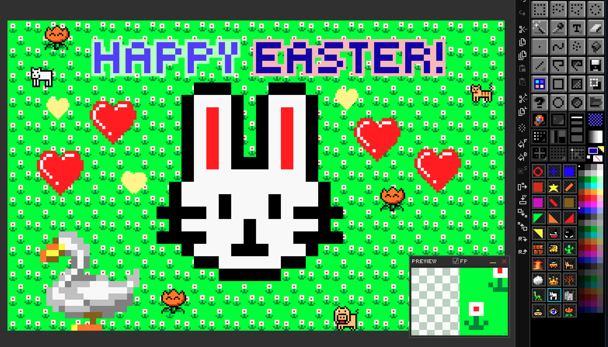

# Ch. 09  🪄 Custom Brushes & Drawer Panel

> **What you'll learn:** How to capture, transform, recolor and stamp custom brushes; the 30-slot Drawer panel for brush / pattern / gradient libraries; and DRAW's six dithering algorithms.

---

## Custom Brushes — Capture, Transform & Paint

> 🎯 **Goal:** Create and use custom brushes.

A **custom brush** is any selection captured into the brush slot — DRAW remembers the pixels and treats them as the active stamp for every drawing tool that supports stamping.

### Capturing

Make a selection, then capture it as a brush via the Brush menu, the Organizer button, or the Command Palette. There are two capture modes:

- **From Current Layer** — only non-transparent pixels.
- **From Selected Layers** — union mask across the multi-selection.

Non-rectangular shapes are preserved via the alpha channel.

### AnimBrush - a brush with a picture per frame

On a sprite sheet (a document with frames), **ANIM → AnimBrush → Pick Up** makes a brush
that has one picture - a *cel* - for each frame:

1. Draw a selection around the part you want inside one frame (a marquee, ellipse, lasso or
   magic wand; the shape is kept).
2. To take only some frames, Ctrl+click them in the lightbox strip first. Otherwise the cels
   come from the frame the selection is in through the last frame.
3. Choose **Pick Up** (the current layer) or **Pick Up Merged** (every visible layer).

DRAW reads the same spot in every frame's cell - the gutter and margin between cells are
skipped - so a walk cycle becomes a walking brush. The tool switches to the Brush, and the
brush under the pointer is always the cel your next stamp will use; the status bar shows it
too (`ANIMBRUSH 3/8 FOLLOWS FRAME`: cel 3 of 8).

**Step modes** (ANIM → AnimBrush):

- **Cel follows the frame** (the default) - on frame 5 the brush uses frame 5's cel. Stamp the
  same spot on each frame and the flame burns there. The frame you picked the brush up from gets
  cel 1; `Alt+\` makes the current frame cel 1 instead.
- **Next cel each click** - every press moves on one cel, so a row of torches on one frame
  don't flicker in step. On a picture without frames the brush always works this way.
- **Every frame at once** - one press stamps the brush on every frame, each with its own cel,
  cut at the edge of each frame's cell. Ctrl+Z takes the whole thing away in one step.

**Order** runs the cels Forward, Reverse, Ping-Pong (1 2 3 4 3 2 ...) or Once (holds the last
cel). `Alt+]` and `Alt+[` step to the next / previous cel. `Ctrl+B`
drops the AnimBrush; `Ctrl+B` over a selection still makes an ordinary one-picture brush.
Switching to Pattern or Gradient mode puts the AnimBrush away with its cels, and Color mode
brings it back.

Everything in **Transform controls** and the recolor / outline modes below works on an
AnimBrush too: Rotate 90° (`>` / `<`), Scale 2x (`Ctrl+Home` / `Ctrl+End`) and Outline
(`Shift+O`) change **every** cel, not just the one you see; Flip, Scale and Recolor are applied
to whichever cel a stamp uses. With the **Eraser** an AnimBrush erases each frame's own cel
shape (with *Every frame at once*, the whole animation in one press). In the lightbox, a stamp
in another frame's pane lands in that frame and uses that frame's cel.

### Move Brush - a brush that travels across the frames

**ANIM → Move Brush** stamps the brush once in each frame along a path, so a ball rolls or a
bird flies through the animation without placing every frame by hand. It works with any custom
brush; with an AnimBrush the bird flaps as it flies.

1. Pick up a brush (`Ctrl+B` over a selection, or an AnimBrush).
2. Choose **ANIM → Move Brush → Start**. The status bar shows `MOVE BRUSH`.
3. Drag the path in a frame - on the sheet, or in a lightbox pane. A see-through ghost of every
   stamp shows along it, with a dot for each frame. Drag again to try another path.
4. Press `Enter` to stamp it (`Esc` cancels). The first frame gets the brush at the start of the
   path, the last frame at its end, the frames between along the way - each in its own cell.
   `Ctrl+Z` takes the whole move away in one step.

Which frames: the ones selected in the strip (Ctrl+click two or more), else the frame you drag
in through the last frame. In the same menu:

- **Ease** - *None* spaces the stamps evenly; *In* starts slow and speeds up; *Out* starts fast
  and slows down; *In-Out* is slow at both ends.
- **Next Cel Every Frame / 2 / 3 / 4** - with an AnimBrush, how often it moves on to its next cel
  (a slow walk: every 2 frames).

### Transform controls

| Action | Key |
| --- | --- |
| Flip Horizontal | `Home` |
| Flip Vertical | `End` |
| Scale Up | `PgUp` |
| Scale Down | `PgDn` |
| Reset Scale | `/` |

### Modes that work *with* a custom brush

| Tool | Effect |
| --- | --- |
| Brush / Spray | Stamp the brush at every step. |
| Line / Rect / Ellipse / Polygon | Stamp along the geometry. |
| Fill | **Tiled fill** of the brush as a seamless pattern. |
| Eraser | Stamp transparency in the brush shape. |

### Recolor and outline modes

- **Recolor** (`F9`) — paints the brush in the current FG color, preserving its alpha.
- **Outline** (`Shift+O`) — adds a BG-colored outline around the brush silhouette.

### Export

`F12` exports the current brush as a standalone PNG (alpha preserved) — perfect for sharing brushes between projects.

> 🎨 **Try it — leaf scatter**
> 1. Draw a small 8×8 leaf on a transparent layer.
> 2. Marquee around it; capture as custom brush.
> 3. Switch to Spray, increase brush size, set FG to a green family.
> 4. Spray a tree's foliage onto a new layer in seconds.

## Drawer Panel — 96 Reusable Slots

> 🎯 **Goal:** Organize and reuse brushes and patterns.

The **Drawer panel** is a docked grid of 96 slots per mode that hold reusable brushes, patterns, or gradients. Each slot is one click away from being the active stamp.

  

### Drawer modes

| Mode | Shortcut | Use for |
| --- | --- | --- |
| Brush | `F1` | Stamping and painting. |
| Gradient | `F2` | Color transitions for fills. |
| Pattern | `F3` | Seamless tiled fills. |

### Storing and managing slots

| Action | Result |
| --- | --- |
| `Shift`+Left-click an empty slot | Store the current brush there. |
| Right-click any slot | Context menu — load, save, clear, replace, export, etc. |
| Drag-and-drop slots | Reorder. |
| Drop image files onto the panel | Batch import as slot brushes. |

**Load an AnimBrush from a file.** **ANIM → AnimBrush → Load…** makes an AnimBrush from an
animated GIF or APNG (its frames, as a player shows them), a PNG or `.draw` with frames (its
cells), or a plain picture that is a row or column of squares (a strip). The cels are cropped
to the area anything is drawn in, keeping each cel's place. Drop such a file on a Drawer bin
and it lands there as an AnimBrush bin (the bin under the pointer if it is empty, else the
first free one); a picture without frames dropped on a bin is an ordinary brush, as before.

**AnimBrush bins.** `Shift`+click a bin while you hold an AnimBrush and the bin keeps every
cel: it shows cel 1 with a small film-strip badge holding the cel count, and while you hover
it the bin plays (at the animation's FPS) - so does the Preview's Bin Quick Look. Click the
bin to get the AnimBrush back, cels and all. Dragging the bin moves its cels with it; storing
a plain brush over it makes it one picture again. AnimBrush bins are saved in `.dset` sets and
in `.draw` files; an older DRAW opens those with the bin's first cel only.

### `.dset` import / export

The drawer state can be saved as a `.dset` file and reloaded later — a clean way to share brush packs and pattern libraries between projects or with other artists. There's a sample set in `DEV/brush-set.dset`.

DRAW 2.8 has **96 slots** per mode (earlier versions had 30). Sets and `.draw` files keep working both ways: an older DRAW opens a new file with its first 30 slots, and a new DRAW opens an old file with the slots after 30 empty.

### Mini palette

The Drawer can show a **mini palette** beside its bins for quick FG / BG selection (left / right click). It is **off by default**: turn it on in **Settings → Panels → Drawer → Mini Palette**. With it off, the bins take its space (more columns and rows). For a full swatch panel, see **View → Swatches**.

### Narrow and wide toolboxes

The drawer fits the toolbox column's width (drag the toolbox's inner edge, or
set its columns in a workspace):
- **Wider than the default 4 columns:** up to 6 bin columns, so fewer rows.
- **Without the mini palette** (the default): as many bin columns as fit the width, up to 6.
- **Narrow:** fewer bin columns. When even one bin can't sit beside the mini palette (if it's on), the palette moves under the bins.
- **Not every row fits:** **`Shift`+wheel** over the bins scrolls them. The plain wheel still switches `.dset` sets.
- **The bins fill the width:** they grow to span the drawer, so no strip is left at the right.
- **See a bin big:** hover it and the Preview panel shows it enlarged (Bin Quick Look, see Chapter 11).
- **Zoom:** **`Ctrl`+wheel** over the bins zooms them: wheel up gives fewer, bigger bins per row (down to 1), wheel down gives more, smaller ones (up to 12). DRAW remembers the zoom (`DRAWER_BIN_COLS` in DRAW.cfg). To go back to the automatic size, right-click a bin and choose **Bin Size: Auto**.

### 1-bit patterns

Patterns can be stored with **opaque backgrounds** (1-bit black/white) so that flooding with a 1-bit pattern under a colored FG produces classic Aldus PageMaker / DPaint dither patterns.

### Paint modes

The drawer ties into three paint modes that affect Fill and Brush behaviour:

- **Normal** — solid current FG color.
- **Pattern** — tile the active drawer slot.
- **Gradient** — interpolate between palette stops via the active gradient slot.

### Dithering algorithms

When painting gradients (or applying Posterize) you can pick from:

- **Ordered** — Bayer 2×2, 4×4, 8×8.
- **Floyd-Steinberg** — error diffusion.
- **Atkinson** — classic Mac dither.
- **Stucki** — heavier diffusion.
- **Blue Noise** — perceptually uniform.

---

➡️ Next: [Chapter 10 — File I/O & Export](10-file-io.md)
